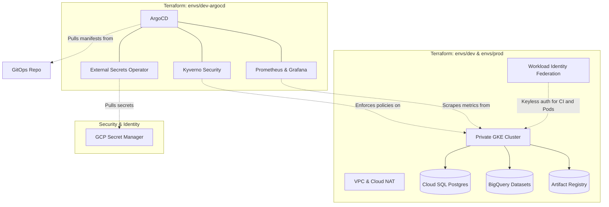

# Retail Data Platform: Infrastructure as Code


This repository provisions the cloud infrastructure for the Retail Data Platform using **Terraform**. It follows a strict zero-trust, Infrastructure-as-Code approach: no resources are created through the GCP Console, and no long-lived JSON service account keys exist anywhere.

## Related Repositories

This platform uses a multi-repo architecture:

| Repository | Purpose |
|---|---|
| [RetailDataPlatform](https://github.com/benkivuva/RetailDataPlatform) | Application code (Python, dbt, Flask, Dagster) |
| [retail-platform-gitops](https://github.com/benkivuva/retail-platform-gitops) | Kubernetes manifests reconciled by ArgoCD |
| **retail-platform-infrastructure** (this repo) | Terraform for GCP infrastructure and cluster bootstrap |

## Architecture

Infrastructure is split into separate Terraform states. This isolates environments and resolves the chicken-and-egg problem between the cluster and the tooling that runs on it.

| State | Purpose |
|---|---|
| `envs/dev` | Dev infrastructure: VPC, private GKE cluster, Cloud SQL (Postgres), BigQuery datasets, Artifact Registry, GCS buckets |
| `envs/prod` | Production replica of dev with larger node pools and `deletion_protection` enabled (plan-only, see below) |
| `envs/dev-argocd` | Cluster bootstrap via the Helm provider: ArgoCD, External Secrets Operator, Kyverno, and the Prometheus/Grafana stack (`monitoring.tf`) |



## Key Features

- **100% Infrastructure as Code:** Everything from VPC subnets to BigQuery datasets is defined in reusable Terraform modules.
- **Private GKE cluster:** Nodes have no public IPs. Cloud NAT handles egress, and Master Authorized Networks restrict control plane access.
- **Keyless authentication:** Workload Identity Federation (WIF) covers both GitHub Actions CI and GKE pods. No JSON keys exist.
- **Infrastructure CI/CD:** GitHub Actions runs `terraform plan` on pull requests and requires manual approval for `terraform apply` on merges to `main`.
- **Cost optimization:** GKE Spot instances for the web tier and `db-f1-micro` for the dev database.
- **Policy enforcement:** Kyverno blocks root containers and other insecure pod configurations.

## Repository Structure

```text
.
├── modules/            # Reusable modules (GKE, CloudSQL, IAM, Networking, Artifact Registry)
├── envs/
│   ├── dev/            # Core GCP infrastructure (development)
│   ├── prod/           # Production infrastructure (plan-only, cost-optimized)
│   └── dev-argocd/     # Cluster bootstrap (ArgoCD, ESO, Prometheus, Kyverno)
├── .github/workflows/  # CI pipelines for Terraform plan and apply
└── bin/                # Helper scripts (e.g. refresh-ip.sh)
```

## Prerequisites

- [Terraform](https://developer.hashicorp.com/terraform/install) `>= 1.9`
- [Google Cloud CLI](https://cloud.google.com/sdk/docs/install) (`gcloud`), authenticated with `gcloud auth application-default login`
- [`kubectl`](https://kubernetes.io/docs/tasks/tools/) and the `gke-gcloud-auth-plugin`
- Permission to create resources in the target GCP project
- Your workstation IP allowed in Master Authorized Networks (see [Local Access](#local-access))

## How to Deploy

**1. Provision the cloud infrastructure**

```bash
cd envs/dev
terraform init
terraform plan
terraform apply
```

**2. Connect `kubectl` to the new cluster**

```bash
gcloud container clusters get-credentials dev-retail-platform-gke --region us-central1
```

**3. Bootstrap cluster tooling** (ArgoCD, ESO, Prometheus, Kyverno)

```bash
cd ../dev-argocd
terraform init
terraform apply
```

Once ArgoCD is running, it takes over and syncs workloads from the [GitOps repo](https://github.com/benkivuva/retail-platform-gitops).

## Local Access

The GKE control plane is private and restricted by Master Authorized Networks. If your public IP changes, refresh your access:

```bash
./bin/refresh-ip.sh
```

## CI/CD Workflow

| Event | Action |
|---|---|
| Pull request | `terraform fmt`, `validate`, and `plan`; the plan output is reviewed before merge |
| Merge to `main` | `terraform apply` runs after manual approval |

Authentication uses Workload Identity Federation, so the pipelines hold no stored credentials.

## Environment Notes

- **dev:** Optimized for cost (Spot nodes, `db-f1-micro`). Safe to tear down and recreate.
- **prod:** Larger node pools and `deletion_protection` enabled. Currently plan-only; applying it is a deliberate manual decision.

## Tear Down (dev only)

Destroy in reverse order so cluster tooling is removed before the cluster:

```bash
cd envs/dev-argocd && terraform destroy
cd ../dev && terraform destroy
```

`deletion_protection` must be disabled before destroying protected resources such as the production database.

## Contributing

1. Branch from `main` and make your change.
2. Run `terraform fmt -recursive` and `terraform validate`.
3. Open a pull request and review the generated plan.
4. Merge after approval; the apply step requires manual sign-off.